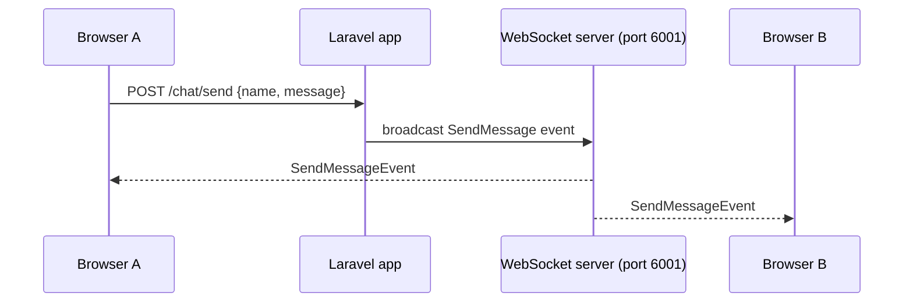

# Laravel WebSockets Chat

A chat app I made to learn Laravel broadcasting. Instead of paying for Pusher, it runs its own WebSocket server. When someone sends a message, Laravel broadcasts it as an event and every open browser gets it straight away.

## How it works



The WebSocket server is [beyondcode/laravel-websockets](https://github.com/beyondcode/laravel-websockets). It runs inside the Laravel app and speaks the Pusher protocol, so the normal Pusher PHP and JavaScript clients work with it.

`App\Events\SendMessage` implements `ShouldBroadcast` and sends `name`, `message` and `time` on the public `SendMessageEvent` channel. `SocketsController` signs subscription requests at `/api/sockets/connect`. The chat page, `resources/views/chat-app-example.blade.php`, uses Vue 2 and pusher-js to connect, show whether it's connected, and add new messages as they come in.

Built with Laravel 9, PHP 8, Vue 2 and Laravel Breeze.

## Running locally

```sh
composer install
cp .env.example .env && php artisan key:generate
# in .env: BROADCAST_DRIVER=pusher and any PUSHER_APP_ID / KEY / SECRET values
php artisan migrate

php artisan websockets:serve   # WebSocket server on port 6001
php artisan serve              # app on http://127.0.0.1:8000
```

Open the app in two browser windows and send a message from one. It shows up in both.
